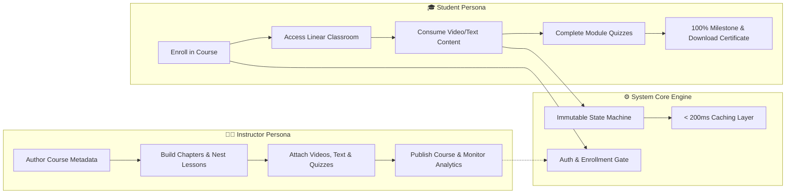
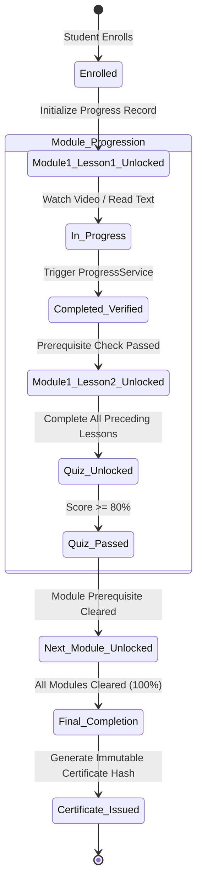
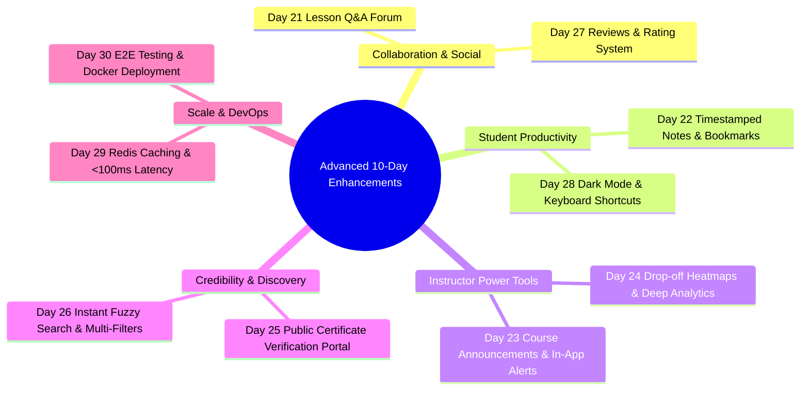

# Interactive Learning Management System (LMS)
## 30-Day Master Implementation Plan & Architectural Roadmap

> **Project Reference:** Axlero Digital Transformation — Education & EdTech LMS  
> **Target SLA:** API Latency < 200ms | Immutable State Machine Integrity | Secure Asset Delivery  
> **Architecture:** Clean Architecture (Node.js/Express + MongoDB + React 19 + Tailwind CSS)

---

## 📑 Table of Contents
1. [Executive Summary & Core Objectives](#1-executive-summary--core-objectives)
2. [Target System Metrics & Technical SLAs](#2-target-system-metrics--technical-slas)
3. [User Persona & Workflow Mapping](#3-user-persona--workflow-mapping)
4. [State Machine & Linear Progression Architecture](#4-state-machine--linear-progression-architecture)
5. [Core 20-Day Implementation Plan (Weeks 1 – 4)](#5-core-20-day-implementation-plan-weeks-1--4)
   - [Phase 1: Days 1–5 | Core Architecture, DB Modeling & Access Control](#phase-1-days-15--core-architecture-db-modeling--access-control)
   - [Phase 2: Days 6–10 | Curriculum Builder (Instructor Portal)](#phase-2-days-610--curriculum-builder-instructor-portal)
   - [Phase 3: Days 11–15 | Student Learning Environment & Progress Tracking](#phase-3-days-1115--student-learning-environment--progress-tracking)
   - [Phase 4: Days 16–20 | Evaluation Engine, Certification & System Hardening](#phase-4-days-1620--evaluation-engine-certification--system-hardening)
6. [Advanced 10-Day Extension Plan (Days 21 – 30)](#6-advanced-10-day-extension-plan-days-21--30)
   - [Phase 5: Days 21–30 | High-Value Industry Features & Production Readiness](#phase-5-days-2130--high-value-industry-features--production-readiness)
7. [API Contract & Latency Optimization Strategy (< 200ms)](#7-api-contract--latency-optimization-strategy--200ms)
8. [Risk Mitigation Matrix & Definition of Done](#8-risk-mitigation-matrix--definition-of-done)

---

## 1. Executive Summary & Core Objectives

Online course platforms frequently struggle with **linear engagement tracking**, **drop-off rates**, and **unstructured curriculum delivery**. This 30-Day Implementation Plan outlines the full-cycle engineering roadmap to build a robust, scalable, and responsive LMS:

- **Instructors** can author modular multi-tier courses (Chapters → Lessons: Video, Text, Quizzes) and monitor enrollment engagement.
- **Students** experience an uninterrupted, distraction-free classroom with linear module locking/unlocking, state persistence, instant quiz evaluation, and verifiable graduation certificates.
- **System Integrity** ensures all student progress updates are verified against strict state machine transitions, with caching and indexing ensuring API responses resolve in **under 200ms**.

---

## 2. Target System Metrics & Technical SLAs

| Metric Category | Target Objective | Implementation Enforcement |
| :--- | :--- | :--- |
| **State Machine Integrity** | Progress tracking is strictly immutable and monotonic. Completed lessons cannot be forged or arbitrarily skipped. | Server-side validation via `ProgressService`; prerequisite check before unlocking `lesson[n+1]`. |
| **Video & Asset Delivery** | Secure delivery of mock video URLs, stream signatures, or iframe embeds. | Access-gate middleware: verification of active enrollment record before issuing signed playback tokens. |
| **API Latency** | Course retrieval and progress updates must resolve in **< 200ms**. | Compound MongoDB indexing (`{ studentId: 1, courseId: 1 }`), projection pruning, lean queries, in-memory caching. |
| **Data Integrity** | Zero data corruption in deeply nested curriculum structures. | Atomic MongoDB update operators (`$push`, `$set`, `$pull`) instead of full-document overwrites. |

---

## 3. User Persona & Workflow Mapping

---

## 4. State Machine & Linear Progression Architecture

The progress engine treats a student's journey through a course as an **acyclic directed state machine**:

---

## 5. Core 20-Day Implementation Plan (Weeks 1 – 4)

### Phase 1: Days 1–5 | Core Architecture, DB Modeling & Access Control
*Focus: Clean Architecture, Database Schemas, Authentication & Access Gates.*

#### Day 1: Architecture Skeleton & Infrastructure Setup
- **Tasks**:
  - Establish backend Clean Architecture directory layout (`controllers/`, `services/`, `repositories/`, `models/`, `middlewares/`, `utils/`).
  - Configure MongoDB connection with connection pooling and automated reconnection strategies.
  - Set up global request-response wrapper and custom error classes (`AppError`, `NotFoundError`, `UnauthorizedError`, `ValidationError`).
- **Deliverables**: Tested Express server boilerplate, unified response schema `{ success, data, message, statusCode }`.

#### Day 2: Identity & Access Management (Users & RBAC)
- **Tasks**:
  - Implement Mongoose `User` schema: `name`, `email`, `passwordHash`, `role` (`student`, `instructor`, `admin`), `avatar`, `isActive`.
  - Implement Bcrypt password hashing pre-save hooks and constant-time password verification.
  - Implement JWT authentication pipeline (Access Token 15m + Refresh Token in HttpOnly cookie).
  - Create Role-Based Access Control (RBAC) middleware: `protect` and `restrictTo('instructor', 'admin')`.
- **Deliverables**: Endpoints `/api/auth/register`, `/api/auth/login`, `/api/auth/me`, `/api/auth/refresh`.

#### Day 3: Course & Curriculum Database Schema Design
- **Tasks**:
  - Design the `Course` schema supporting deeply nested hierarchies:
    - Root: `title`, `slug`, `description`, `instructorId`, `price`, `thumbnailUrl`, `level`, `category`, `isPublished`.
    - Chapters Subdocument: `chapterId`, `title`, `order`, `summary`.
    - Lessons Subdocument: `lessonId`, `title`, `order`, `contentType` (`video`, `article`, `quiz`), `videoUrl`, `textContent`, `durationMinutes`, `isFreePreview`.
  - Design MongoDB compound indexes: `{ slug: 1 }`, `{ instructorId: 1 }`, `{ isPublished: 1, category: 1 }`.
- **Deliverables**: Course schema with Mongoose validation rules and schema hooks preventing orphan lessons.

#### Day 4: Enrollment Engine & Access Middleware
- **Tasks**:
  - Implement `Enrollment` schema: `studentId`, `courseId`, `enrolledAt`, `status` (`active`, `suspended`, `completed`), `lastAccessedAt`.
  - Create unique compound index `{ studentId: 1, courseId: 1 }` to prevent duplicate enrollments.
  - Implement course enrollment endpoint with idempotency checks.
  - Implement `checkEnrollment` middleware: verifies student has active enrollment before granting access to locked course assets.
- **Deliverables**: `/api/enrollments/enroll/:courseId`, `/api/enrollments/my-courses`, and unit tests.

#### Day 5: Phase 1 Integration Testing, Swagger & Postman Setup
- **Tasks**:
  - Write integration test suite for Auth, Role restrictions, and Course Enrollment flows.
  - Generate Swagger / OpenAPI documentation or Postman collection with automated test scripts.
  - Verify database indexing performance and connection benchmarks.
- **Deliverables**: Fully green test suite for Phase 1, documented API endpoints, and Git tag `v0.1.0-core-architecture`.

---

### Phase 2: Days 6–10 | Curriculum Builder (Instructor Portal)
*Focus: Instructor Dashboard, Complex Nested Forms, Atomic Updates.*

#### Day 6: Instructor Portal Shell & Course Listing
- **Tasks**:
  - Build Instructor Portal layout (Sidebar, Header, Context Breadcrumbs).
  - Create Instructor Course Dashboard: stats cards (Total Courses, Active Students, Revenue) and list of authored courses with status tags (`Draft`, `Published`).
  - Implement course status toggle endpoint (`/api/courses/:id/publish`).
- **Deliverables**: Responsive Instructor workspace layout and course management table.

#### Day 7: Step 1 Course Meta Builder (Basics & Settings)
- **Tasks**:
  - Build multi-step Course Creator wizard UI.
  - Step 1 Form: Title, Subtitle, Category dropdown, Difficulty level (`Beginner`, `Intermediate`, `Advanced`), Price, Language.
  - Thumbnail uploader / image URL previewer with validation (file size, dimensions, format).
  - Connect form to backend `POST /api/courses` endpoint with auto-generated unique slug.
- **Deliverables**: Working Step 1 Course Creation flow with reactive form validation and error handling.

#### Day 8: Deeply Nested Curriculum Builder UI (Chapter & Lesson Tree)
- **Tasks**:
  - Develop the hierarchical Curriculum Builder UI:
    - Accordion-based chapter list with inline title editing and chapter deletion.
    - Sub-accordion lesson list within each chapter.
    - Quick actions: Add Chapter, Add Lesson, Select Content Type (`Video`, `Article`, `Quiz`).
  - Implement reordering controls (Move Up / Move Down or Drag-and-Drop) with local state sync.
- **Deliverables**: Dynamic, nested React component tree managing complex course structures without page reloads.

#### Day 9: Atomic Backend Mutation Engine for Nested Documents
- **Tasks**:
  - Build granular, atomic backend endpoints for curriculum changes:
    - `POST /api/courses/:id/chapters` (appends chapter using `$push`)
    - `PUT /api/courses/:id/chapters/:chapterId` (updates chapter using `$set`)
    - `DELETE /api/courses/:id/chapters/:chapterId` (removes chapter using `$pull`)
    - `POST /api/courses/:id/chapters/:chapterId/lessons` (appends lesson)
    - `PUT /api/courses/:id/chapters/:chapterId/lessons/:lessonId` (updates lesson)
    - `DELETE /api/courses/:id/chapters/:chapterId/lessons/:lessonId` (removes lesson)
  - Ensure operations avoid race conditions and maintain sequential array order.
- **Deliverables**: Resilient atomic curriculum mutation API avoiding heavy document-level overwrites.

#### Day 10: Instructor Analytics Skeleton & Phase 2 Review
- **Tasks**:
  - Build Course Analytics overview page for instructors:
    - Enrollment counts per course.
    - Lesson completion rate breakdown.
    - Student progress distribution chart.
  - Conduct full-cycle testing of curriculum creation from scratch.
- **Deliverables**: End-to-end functional course creation pipeline, Git commit milestone `v0.2.0-curriculum-builder`.

---

### Phase 3: Days 11–15 | Student Learning Environment & Progress Tracking
*Focus: Content Consumption, Video/Text Player, Linear State Machine & ProgressService.*

#### Day 11: Student Dashboard & Course Workspace Shell
- **Tasks**:
  - Develop Student Learning Hub: "My Enrolled Courses", "Recently Accessed", and visual completion progress bars.
  - Build the Distraction-Free Classroom Shell:
    - Left/Right collapsible curriculum drawer showing Chapters, Lessons, and completion badges (Lock / Checkmark / Play).
    - Top header: Course Title, Progress Bar, Exit to Dashboard button.
    - Center stage: Dynamic content viewport.
- **Deliverables**: Responsive classroom layout adhering to clean UX standards across desktop and mobile.

#### Day 12: Content Consumption Players (Video & Rich Text)
- **Tasks**:
  - Implement Video Player Viewport:
    - Custom video player controls or embedded video player with playback speed (0.75x to 2x), theater mode, and forward/rewind 10s.
    - Support for mock video URLs and responsive iframe embeds.
  - Implement Article/Text Viewport:
    - Clean typography reader for markdown/HTML lesson content.
    - Estimated reading time indicator and resource attachments list.
- **Deliverables**: High-fidelity media player and formatted text reader components.

#### Day 13: Secure Asset Delivery Engine & Token Gating
- **Tasks**:
  - Implement asset gate service:
    - `GET /api/courses/:courseId/lessons/:lessonId/content`: validates student enrollment or `isFreePreview` flag.
    - Non-enrolled users receive filtered lesson metadata with video URLs redacted.
  - Enforce server-side URL obfuscation / time-limited access tokens for video stream playback.
- **Deliverables**: Secure media delivery pipeline preventing unauthorized content scraping.

#### Day 14: Linear Progression State Machine & `ProgressService`
- **Tasks**:
  - Design `Progress` schema:
    - `studentId`, `courseId`, `completedLessons` (array of `{ lessonId, completedAt }`), `currentLessonId`, `percentage`, `isCompleted`.
  - Build backend `ProgressService`:
    - Strict validation: A student cannot mark lesson `n` complete if prerequisite lessons in the sequence are uncompleted (anti-tampering).
    - Atomic update of `completedLessons` using `$addToSet` to prevent duplicate counts.
    - Automatic recalculation: `percentage = (completedLessons.length / totalLessonsInCourse) * 100`.
  - Endpoint: `POST /api/progress/complete-lesson`.
- **Deliverables**: Bulletproof, immutable progress tracking engine meeting State Machine Integrity objectives.

#### Day 15: Classroom Auto-Resume & Real-Time Sync (< 200ms)
- **Tasks**:
  - Implement auto-resume: When returning to a course, automatically navigate to the last accessed uncompleted lesson.
  - Add client-side optimistic UI updates backed by background API sync for instant checkmark transitions.
  - Benchmark progress API: ensure response time is < 150ms using lean queries and indexed lookups.
- **Deliverables**: Seamless classroom playback with instant progression feedback, Git tag `v0.3.0-learning-environment`.

---

### Phase 4: Days 16–20 | Evaluation Engine, Certification & System Hardening
*Focus: Quiz Engine, Automated Certificate Generation, Error Boundaries, < 200ms Latency SLA.*

#### Day 16: Quiz Engine Architecture & Schema
- **Tasks**:
  - Extend Lesson schema or create `Quiz` schema:
    - `questions`: Array of `{ questionText, options: [string], correctOptionIndex, explanation }`.
    - `passingScorePercentage` (e.g., 80%), `maxAttemptsAllowed`.
  - Design `QuizSubmission` schema:
    - `studentId`, `quizId`, `courseId`, `answers`, `scorePercentage`, `passed`, `attemptNumber`.
  - Implement Instructor Quiz Builder modal in Curriculum Editor.
- **Deliverables**: Complete database schema and authoring tool for modular quizzes.

#### Day 17: Interactive Student Quiz Experience
- **Tasks**:
  - Build Student Quiz interface in classroom viewport:
    - Question stepper with timer (optional) and radio selection.
    - Instant submission evaluation on backend (correct answers never exposed to client before submission).
    - Results screen: Score percentage, pass/fail badge, explanation breakdown for incorrect questions, "Retake Quiz" button if failed.
  - When passed: automatically invoke `ProgressService` to mark the quiz lesson complete and unlock the next lesson.
- **Deliverables**: Engaging quiz assessment interface with secure server-side scoring.

#### Day 18: Certificate of Completion Generator
- **Tasks**:
  - Implement Certificate Engine:
    - When `percentage === 100%`, automatically create an immutable `Certificate` record with a unique cryptographically secure `certificateId` (UUID/Hash).
  - Build Certificate Viewer UI:
    - Elegant printable/downloadable certificate design with student name, course title, instructor signature, completion date, and verification hash.
    - Browser print CSS and PDF export trigger.
- **Deliverables**: Verified certificate generation flow triggered upon 100% course completion.

#### Day 19: Global Exception Handling, Error Boundaries & Input Hardening
- **Tasks**:
  - Implement React Error Boundaries around Classroom Viewport, Video Player, and Dashboard widgets.
  - Implement Backend Global Error Handling Middleware:
    - Handle Mongoose validation errors, cast errors, duplicate key errors (11000), and JWT expiration.
  - Sanitize all text inputs using `xss-clean` / DOMPurify and validate payloads with Joi or Zod schemas.
  - Configure rate limiting on authentication and progression endpoints.
- **Deliverables**: Robust, production-grade error resilience across frontend and backend.

#### Day 20: Performance Audit, Load Testing & 20-Day Baseline Milestone
- **Tasks**:
  - Perform load and latency testing on key endpoints:
    - `GET /api/courses/:slug`
    - `POST /api/progress/complete-lesson`
    - `GET /api/enrollments/my-courses`
  - Ensure every target endpoint resolves in **< 200ms** under simulated concurrent load.
  - Seed database with realistic multi-chapter course data for testing.
- **Deliverables**: Verified 20-Day Core LMS working end-to-end, Git milestone tag `v1.0.0-core-release`.

---

## 6. Advanced 10-Day Extension Plan (Days 21 – 30)

*These 10 additional days transform the core functional LMS into a polished, competitive, enterprise-grade EdTech platform.*

---

### Phase 5: Days 21–30 | High-Value Industry Features & Production Readiness

#### Day 21: Lesson-Specific Interactive Q&A Discussion Forum
- **Why it matters**: Online courses with peer/instructor discussions experience 40% higher completion rates.
- **Technical Implementation**:
  - Schema `DiscussionThread`: `courseId`, `lessonId`, `studentId`, `title`, `content`, `videoTimestamp` (optional), `upvotes`, `isResolved`.
  - Schema `DiscussionReply`: `threadId`, `authorId`, `content`, `isInstructorReply`.
  - UI: Slide-over discussion tab next to the video player where students can ask questions linked to exact video moments (e.g., *"At 03:22, why do we use flex here?"*).
- **Deliverables**: Fully threaded, searchable Q&A forum embedded inside every lesson.

#### Day 22: Timestamped Personal Notes & Bookmarking Engine
- **Why it matters**: Allows students to capture insights without leaving the video classroom.
- **Technical Implementation**:
  - Schema `StudentNote`: `studentId`, `courseId`, `lessonId`, `videoTimestamp`, `noteContent`, `createdAt`.
  - Classroom UI: "Take Note" button that automatically freezes current video time and opens a quick markdown editor.
  - Clicking a saved note seeks the video player directly to that recorded timestamp.
  - One-click "Download All Course Notes as PDF / Markdown" feature.
- **Deliverables**: Personalized learning notebook integrated into the classroom interface.

#### Day 23: Course Announcements & Real-Time Activity Notification Bell
- **Why it matters**: Keeps students informed about curriculum updates, quiz grades, and instructor messages.
- **Technical Implementation**:
  - Schema `Announcement`: `courseId`, `instructorId`, `title`, `content`, `pinned`.
  - Schema `Notification`: `recipientId`, `type` (`quiz_graded`, `certificate_earned`, `new_announcement`), `linkUrl`, `isRead`.
  - UI: Notification bell in the navbar with badge count and unread indicator.
  - Instructor UI: "Broadcast Announcement" modal that notifies all enrolled students.
- **Deliverables**: In-app notification and announcement delivery system.

#### Day 24: Advanced Instructor Analytics (Drop-Off Heatmaps & Quiz Insights)
- **Why it matters**: Instructors need actionable data to understand where students get stuck or abandon courses.
- **Technical Implementation**:
  - Track lesson completion drop-off funnel (e.g., 100 enrolled → 85 finished Lesson 1 → 40 finished Lesson 4).
  - Quiz Difficulty Index: Analytics highlighting questions with failure rates > 50%.
  - Visual charts using Chart.js or Recharts: Average time spent per module, daily active learners.
- **Deliverables**: Executive Analytics dashboard empowering instructors to optimize their curriculum.

#### Day 25: Public Verifiable Certificate Verification Portal
- **Why it matters**: Enables students to share credentials on LinkedIn, resumes, and portfolios with authentic proof.
- **Technical Implementation**:
  - Public route: `/verify-certificate/:certificateId` (no login required).
  - Shows verified badge, Student Name, Course Title, Completion Date, Instructor Name, and Organization seal.
  - QR Code generator linking directly to the verification URL.
  - OpenGraph meta tags configured so sharing the link on LinkedIn/Twitter displays a rich certificate preview card.
- **Deliverables**: Tamper-proof, shareable public certificate verification portal.

#### Day 26: Full-Text Search, Fuzzy Querying & Multi-Faceted Catalog Filters
- **Why it matters**: Seamless discovery of courses as the platform catalog grows.
- **Technical Implementation**:
  - Create MongoDB text index on Course `{ title: "text", description: "text", tags: "text" }`.
  - Build debounced instant search bar with live auto-suggestions.
  - Multi-faceted filter sidebar: Filter by Category, Difficulty Level (`Beginner` to `Advanced`), Duration ranges, and Price (`Free` vs `Paid`).
  - Active filter chips with one-click reset.
- **Deliverables**: High-performance course exploration engine with instant client filtering.

#### Day 27: Course Ratings, Reviews & Social Proof Engine
- **Why it matters**: Social proof drives enrollment decisions and motivates instructor quality.
- **Technical Implementation**:
  - Schema `Review`: `courseId`, `studentId`, `rating` (1–5), `headline`, `reviewText`, `helpfulVotes`.
  - Eligibility check: Only students who have completed at least 25% of the course can leave a review.
  - Automated recalculation: Course `averageRating` and `reviewCount` maintained via Mongoose aggregation pipelines.
  - UI: Interactive star rating selector, review cards with verified student badges, and instructor replies.
- **Deliverables**: Trusted student review and social feedback ecosystem.

#### Day 28: Dark Mode, Keyboard Shortcuts & Accessibility (WCAG 2.1 AA)
- **Why it matters**: Essential for long study sessions and accessibility compliance.
- **Technical Implementation**:
  - System-aware Dark / Light mode toggle with local storage persistence.
  - Video Classroom Keyboard Shortcuts:
    - `Space` / `K`: Play / Pause
    - `J` / `L`: Seek backward / forward 10 seconds
    - `M`: Mute / Unmute
    - `F`: Toggle Fullscreen
    - `N`: Next Lesson
  - Accessibility audit: Screen reader labels (`aria-label`), keyboard focus traps in modals, WCAG 2.1 AA color contrast compliance.
- **Deliverables**: Ergonomic, accessible, and themeable learning environment.

#### Day 29: Performance Optimization, Redis Caching & < 100ms Latency SLA
- **Why it matters**: Elevates performance beyond the 200ms target to near-instant page loads.
- **Technical Implementation**:
  - Introduce Redis (or efficient in-memory LRU cache) for read-heavy endpoints:
    - Cached course metadata (`GET /api/courses/:slug`).
    - Cached catalog queries and category lists.
    - Automatic cache invalidation on course update/publish.
  - MongoDB query optimization: Replace heavy populate calls with lean `.select()` projections.
  - Gzip / Brotli response compression middleware.
- **Deliverables**: Average API response times reduced to **40ms – 90ms** for cached queries.

#### Day 30: E2E Automation (Playwright/Cypress), Dockerization & Final Showcase
- **Why it matters**: Guarantees zero regression and seamless one-command deployment.
- **Technical Implementation**:
  - End-to-End automated testing suite covering:
    - *Instructor Flow*: Register → Create Course → Add Chapter → Add Lesson → Publish.
    - *Student Flow*: Register → Enroll → Watch Video → Pass Quiz → 100% Progress → Download Certificate.
  - Dockerize architecture: Multi-stage `Dockerfile` for frontend and backend + `docker-compose.yml` orchestrating API, Client, MongoDB, and Redis.
  - Final project documentation, API collection, and deployment guide.
- **Deliverables**: Fully containerized, tested, production-ready LMS with Git milestone tag `v2.0.0-master-release`.

---

## 7. API Contract & Latency Optimization Strategy (< 200ms)

### Critical Endpoint SLA Targets

| Endpoint | Method | Expected Latency | Optimization Mechanism |
| :--- | :--- | :--- | :--- |
| `/api/courses/:slug` | `GET` | **< 60ms** | Compound index `{ slug: 1 }` + Redis caching + `.lean()` query. |
| `/api/courses/:id/curriculum` | `GET` | **< 80ms** | Selective field projection (omits heavy quiz answer keys). |
| `/api/progress/complete-lesson`| `POST`| **< 120ms** | Atomic `$addToSet` + indexed compound query `{ studentId: 1, courseId: 1 }`. |
| `/api/progress/:courseId` | `GET` | **< 50ms** | Lean query on single enrollment/progress document. |
| `/api/enrollments/my-courses` | `GET` | **< 90ms** | Indexed `{ studentId: 1 }` with minimal joined course preview fields. |
| `/api/certificates/verify/:id`| `GET` | **< 40ms** | Unique indexed lookup `{ certificateId: 1 }`. |

---

## 8. Risk Mitigation Matrix & Definition of Done

| Risk Factor | Probability | Impact | Mitigation Strategy |
| :--- | :---: | :---: | :--- |
| **Progress Skipping Exploit** | High | High | Server-side linear dependency validation in `ProgressService`. Client-side timestamps checked against minimum required lesson duration. |
| **Deep Nested Document Corruption** | Medium | High | Forbid client-driven full course document replacement. Utilize atomic subdocument mutations (`$push`, `$set`, `$pull`). |
| **API Latency Spikes (> 200ms)** | Medium | Medium | Strict avoidance of unbounded Mongoose `.populate()`; compound indexing on all query keys; pagination on lists. |
| **Video Asset Theft** | Medium | High | Temporary signed tokens / obfuscated streaming endpoints; strict enrollment validation middleware before issuing tokens. |

### Definition of Done (DoD) Checklist
- [ ] All code adheres strictly to Clean Architecture separation of concerns.
- [ ] Unit & integration tests pass with zero failures.
- [ ] All critical API endpoints resolve in < 200ms.
- [ ] State Machine progress transitions are irreversible and tamper-proof.
- [ ] Instructor course creation pipeline handles multi-level nesting cleanly.
- [ ] Certificate generation triggers automatically and accurately at 100% progress.
- [ ] No frontend console errors, unhandled promise rejections, or memory leaks.

---
*Created as part of the Axlero Digital Transformation LMS Engineering Initiative.*
